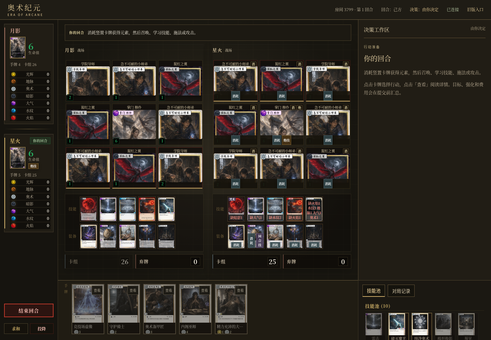

# 前端草稿 PR 审查材料（历史版本）

> 本目录的截图及 PDF 仅记录 2026-10-11 旧版。当前视觉验收已由 [2026-10-16 卡牌可见性修复](../card-visibility-844e696/README.md) 替代，请勿将旧截图视为 PR 最新效果。

代码版本：`f2b78f5e689ad09dfa3cebdd0a974ccab73b3342`。本目录在其后以单独的审查资料提交追加，不修改 `server/`、`web/` 或 `tests/`，不重写原提交。

依赖 [PR #163](https://github.com/Yifeeeeei/EraOfArcaneGame/pull/163)：2026-10-12 API 核验仍 open、未合并，head 为 `dc2fa01196fea6be06313d048d7098b7871eebeb`。因此前端 PR 以 `codex/engine-resolution-162` 为 base，便于仅审查前端及其最小协议增量。不会合并 #163 或部署。

## 界面

截图于 2026-10-11 在最终代码版本上运行真实测试房间产生，逐张人工检查；本次发布前核对 SHA-256 与已审查原图一致。图中只有游戏测试玩家名、随机测试房间和卡牌，不包含真实玩家记录、账号凭据、上传诊断或其他项目内容。

| 文件 | 视口 / 图片尺寸 | 内容 |
| --- | --- | --- |
| [dense-desktop.png](dense-desktop.png) | 1440×1000 | 双满战场、10 个技能和 10 件装备 |
| [dense-mobile.png](dense-mobile.png) | 390×844 / 390×1942 | 高密度手机布局，整页截图 |
| [choice-mobile.png](choice-mobile.png) | 390×844 / 390×2323 | 连续猩红之翼当前选择 |
| [defense-desktop.png](defense-desktop.png) | 1440×1000 | 法术防御工作区 |
| [quality-under-cards.png](quality-under-cards.png) | 1440×1000 | 卡下方详情 |

## 审查资料

- [六页汇总 PDF](EraOfArcaneGame-frontend-review-f2b78f5.pdf)
- [设计说明](../../frontend-design.md)
- [机制覆盖台账](../../frontend-coverage.md)
- [质量复核](../../frontend-quality-review.md)
- [执行报错同步保证与边界](../../frontend-failed-action-sync.md)
- [289 种具名决策盘点](../../frontend-decision-inventory.md)

## 验证记录

下列是针对代码版本 `f2b78f5e689ad09dfa3cebdd0a974ccab73b3342` 已实际完成的云端验证（2026-10-10），不是对 GitHub CI 的替代或预测：

- Go 1.26.1：`go test -count=1 ./...`、`go vet ./...`、`go test -race -count=1 ./...` 全部通过。
- Node：成本、提交状态机测试和 JS 语法检查通过；`git diff --check` 通过。
- 六组真实无头前端脚本通过：`frontend_match.py`、`frontend_reactions.py`、`frontend_primitives.py`、`frontend_dense.py`、`frontend_quality.py`、`frontend_failed_action.py`。
- 2026-10-11 截图刷新时重新运行 match、dense、quality 三组，均通过。没有把截图刷新描述为重新运行全量 Go 验证。
- 覆盖双客户端交接、嵌套反制/响应/防御、红月两次猩红之翼及死亡后候选刷新、分配/排序、错误重试、双击、断线不重发、装备替换、卡下方和观战隐私。
- 实际血沙部分付款后报错：生命已扣至 1，原错误保留；双方与观众同步新版本，旧草稿失效，私有候选没有泄漏。没有通过回滚或隐藏错误来使测试通过。

本次资料提交只增加审核文档/图片/PDF。远端 CI 是否存在及其结果应以 PR checks 为准；不会将本地成功写成远端 CI 通过。

## 限制与交付状态

未穷举全部 728 张卡组合；没有真机或完整无障碍审计。卡图仍依赖网络，云端用同仓库 raw 图源回退；测试环境证书选项不改变生产 TLS 行为。不提供回调事务回滚、持久请求去重、跨重启 epoch 或自动重放。执行内无修改拒绝也保守推进版本并使草稿失效。

资料现按用户授权通过 GitHub 仓库文件交付。此前 Library 保存未完成，没有任何 Library 成功上传的声明。原始房间日志和上传故障诊断不随 PR 发布。
